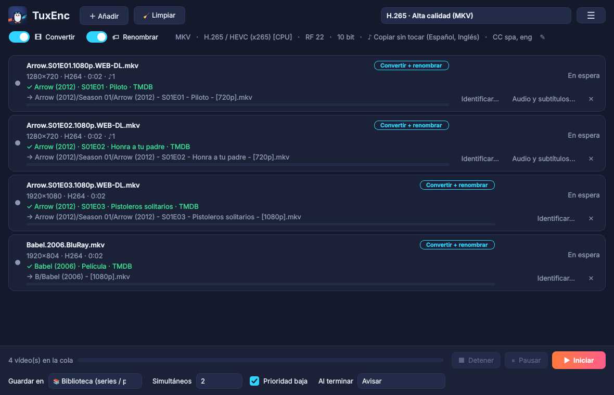
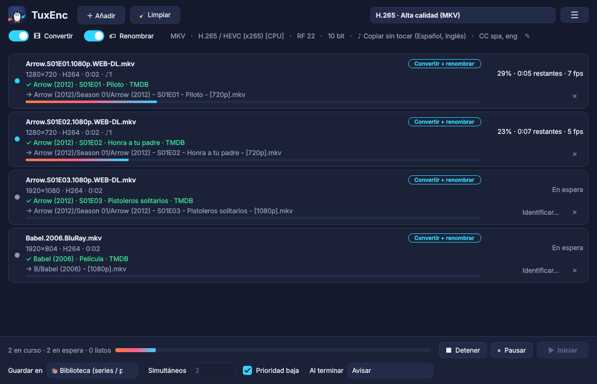
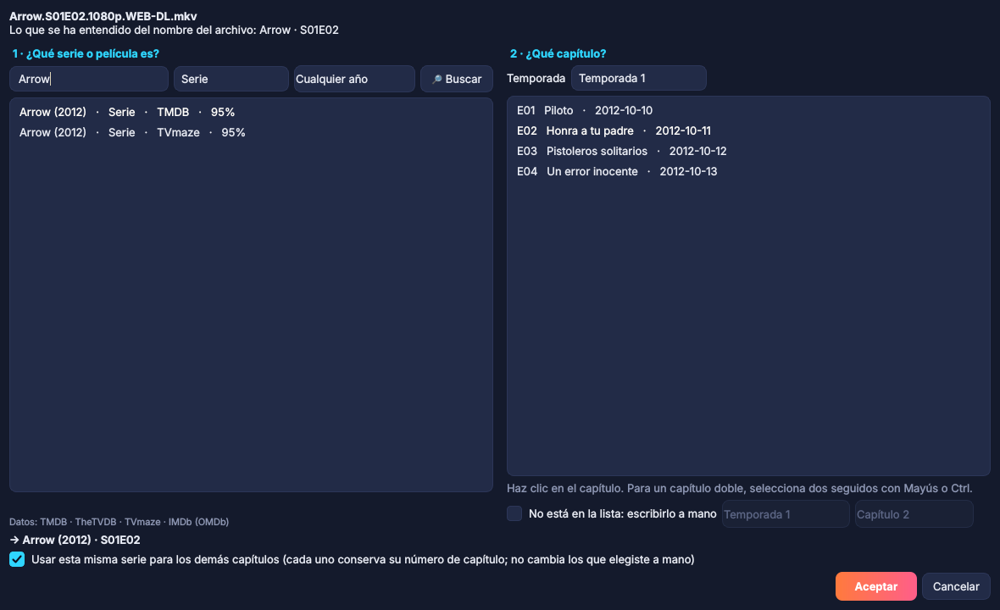
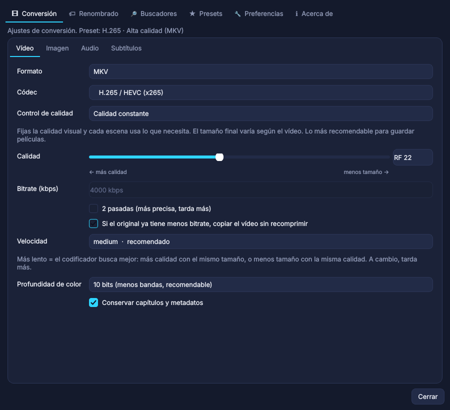
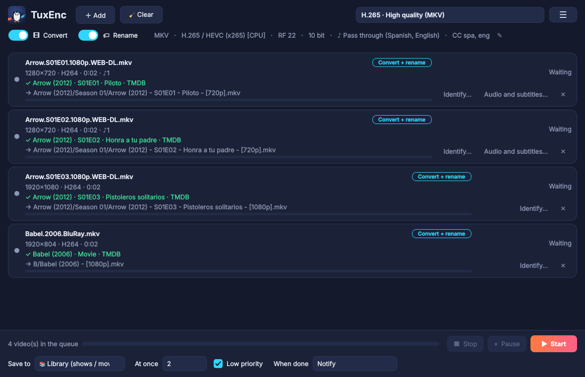
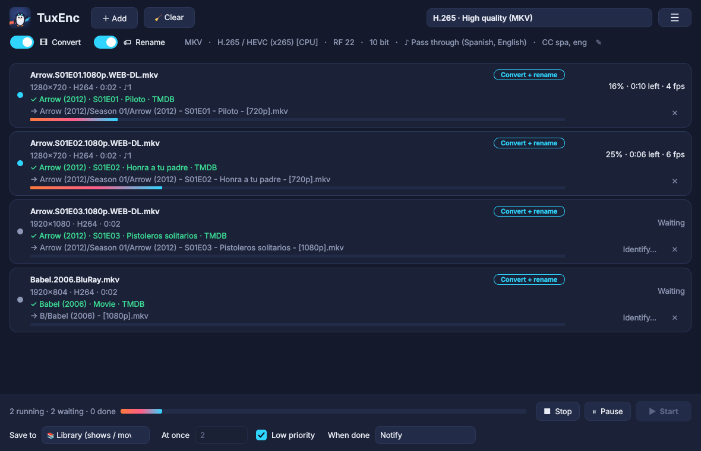
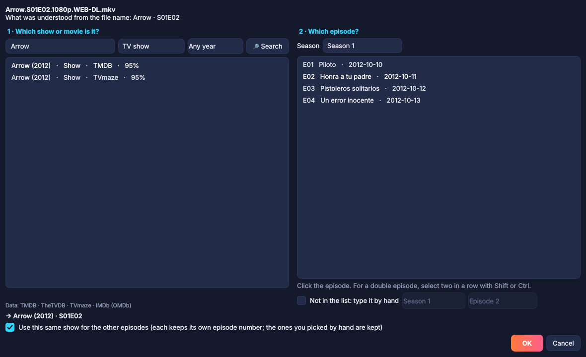
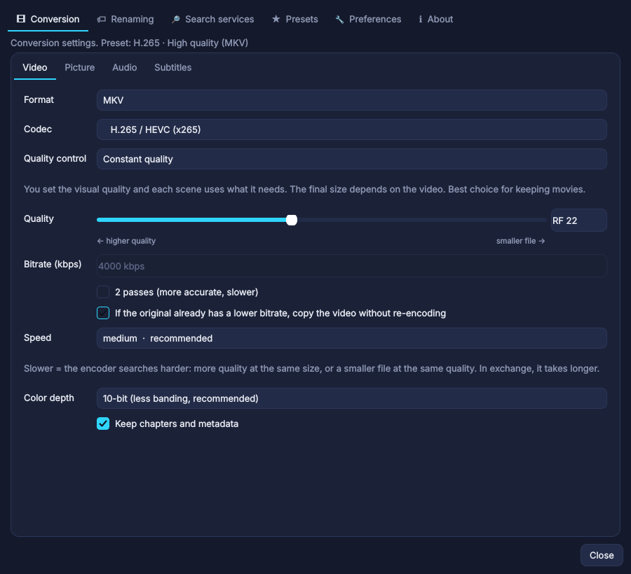

# TuxEnc 🐧🎬

**Español** · [English below](#english)

TuxEnc convierte vídeos a **H.264, H.265, AV1 y VP9**, igual que HandBrake, pero **transcodificando varios vídeos a la vez** y con una interfaz sencilla. Además **identifica y renombra** tus series y películas (TMDB, TheTVDB, TVmaze, IMDb) y las coloca ordenadas en tu biblioteca. Todo se hace desde la ventana: no hace falta abrir ninguna terminal.

  
  
  
  

## Cómo empezar

0. Descarga el zip de la **[última versión](https://github.com/Mortinner/TuxEnc/releases/latest)** (`TuxEnc-…-linux-x86_64.zip`). Si quieres, comprueba la descarga con `sha256sum -c SHA256SUMS`.
1. Descomprime este zip donde quieras.
2. Haz doble clic en **`TuxEnc-…-x86_64.AppImage`**.
3. La primera vez, TuxEnc te pregunta si quieres **integrarlo en el sistema**. Si dices que sí, aparecerá en el menú de aplicaciones y en el escritorio. Después puedes borrar la carpeta que descargaste.

### ¿No se abre con doble clic?

Tu gestor de archivos necesita saber que es un programa. Haz **clic derecho sobre el AppImage → Propiedades** y luego:

| Escritorio | Dónde está la opción |
|---|---|
| **GNOME** (Ubuntu, Fedora…) | Pestaña *Permisos* → activa **«Permitir ejecutar el archivo como un programa»** |
| **KDE Plasma** (Kubuntu, CachyOS, Manjaro…) | Pestaña *Permisos* → marca **«Es ejecutable»** |
| **Cinnamon / MATE** (Linux Mint…) | Pestaña *Permisos* → marca **«Permitir ejecutar el archivo como un programa»** |
| **XFCE** | Pestaña *Permisos* → marca **«Permitir que este archivo se ejecute como un programa»** |

Acepta y vuelve a hacer doble clic.

## Cómo se usa

1. **Arrastra** vídeos o carpetas enteras a la ventana (o usa *＋ Añadir*).
2. Elige un **preset** arriba (por ejemplo *H.265 · Alta calidad*). Con **☰ → Conversión** (o pulsando la línea de resumen) puedes cambiar todo: códec, calidad, bitrate, resolución, filtros, pistas de audio y subtítulos…
3. Pulsa **▶ Iniciar**.

**Añadir vídeos con la cola en marcha:** aparecen como «Nuevo · sin confirmar» y el botón Iniciar pasa a **＋ Añadir (n)** (con solo «Renombrar», **🏷 Renombrar (n)**). Hasta que lo pulses, siguen a los interruptores, al preset y a «Guardar en», así que puedes cambiarlos o corregir la identificación. Al pulsarlo, las conversiones se suman a la cola y esperan su turno; lo que es solo para renombrar se hace en ese momento. Un vídeo confirmado ya no cambia aunque toques los ajustes. Cada fila indica su tarea («Solo convertir», «Solo renombrar»…).

- **Vídeos que ya ocupan poco**: con bitrate medio o constante, si el original ya tiene menos bitrate que el pedido, TuxEnc **copia el vídeo sin recomprimir** (sin perder calidad y en segundos) y solo trabaja el audio, los subtítulos, el formato y el nombre. Se desactiva en ☰ → Conversión → Vídeo. Con el **audio** pasa lo mismo: una pista que ya está en el formato elegido con menos bitrate se copia tal cual (pestaña Audio).
- **🧹 Limpiar**: quita de la lista los terminados, los que no han empezado o todo (vaciar la cola). Nunca borra archivos.
- **Simultáneos**: cuántos vídeos se convierten a la vez. *Auto* calcula el valor ideal para tu procesador. Se cambia con la cola parada.
- **Detener**: cancela lo que está en marcha; lo que no había empezado vuelve a quedar pendiente.
- **Mis idiomas**: indica en qué idiomas quieres el audio y los subtítulos. TuxEnc elige las pistas automáticamente en todos los vídeos. Si quieres cambiar las de un vídeo concreto, usa **Audio y subtítulos…** en esa fila.
- **Al terminar**: avisar, cerrar TuxEnc, suspender o apagar el equipo. Antes de suspender o apagar hay una cuenta atrás de 60 segundos que puedes cancelar.
- **Presets propios**: en **☰ → Presets** puedes guardar tus ajustes como preset, **importar presets de HandBrake** (archivo `.json` exportado desde HandBrake) o exportar los tuyos.
- Tus archivos originales **nunca se sobrescriben**.

## Renombrar y ordenar la biblioteca

Arriba a la izquierda hay dos interruptores: **🎞 Convertir** y **🏷 Renombrar**. Puedes usar uno, el otro o los dos:

| Modo | Qué hace |
|---|---|
| Solo **Convertir** | Convierte los vídeos y los deja con su nombre. |
| Solo **Renombrar** | Identifica cada vídeo y le pone su nombre (y carpeta) al instante. Se puede **↶ Deshacer**. |
| **Los dos** | El vídeo convertido nace ya con su nombre definitivo y en su carpeta. |

- **Identificación**: al añadir vídeos, cada fila dice qué es («Arrow (2012) · S01E02 · Honra a tu padre») y cómo quedará. Si hay dudas, el botón **Identificar…** abre una ventana con dos pasos: a la izquierda eliges la serie o película (o la buscas a mano) y a la derecha, en las series, las temporadas y capítulos disponibles para elegir el tuyo con un clic. Si un capítulo recién estrenado aún no aparece, se puede escribir a mano. La serie elegida se puede aplicar a todos los capítulos de esa serie de una vez.
  - **Títulos de capítulo en español:** se buscan en TMDB (español de España y, si no, de Latinoamérica) y en **TheTVDB**, que suele tener las series menos conocidas traducidas. Si solo existe en inglés y tu archivo ya trae un título («Serie - S01E01 - La mujer alemana»), se conserva el tuyo (se puede desactivar en ☰ → Renombrado). La fila indica «(título de tu archivo)» o «(en inglés)».
  - **¿No sale por su nombre?** (pasa con títulos que solo existen traducidos en algunas webs, p. ej. «Aeropuerto de Dubái»): búscala en IMDb, TMDB, TheTVDB o TVmaze, copia la dirección de su página y pégala en el buscador de **Identificar…**. También vale el código de IMDb (`tt3324124`).
- **Buscadores, sin configurar nada**: TuxEnc trae sus propias claves de **TMDB** y **TheTVDB**, y **TVmaze** no necesita clave. **IMDb (OMDb)** es opcional y necesita tu propia clave gratuita (su límite diario se agotaría si se compartiera). En **☰ → Buscadores** ves el estado de cada uno y puedes poner tus propias claves si lo prefieres. Si ya usabas Retitler, TuxEnc te ofrece importar sus claves.
- **Formatos**: por defecto, así:
  - Series: `Serie (2012)/Season 01/Serie (2012) - S01E02 - Título - [1080p].mkv`
  - Películas: `B/Babel (2006) - [1080p].mkv`

  Se pueden cambiar con presets o a mano. Variables: `{series}` `{season}` `{episode}` `{title}` `{year}` `{resolution}` `{initial}`.
- **Resolución automática** (`{resolution}`): 2160p, 1080p, 720p o 480p. El lado largo del vídeo se compara con los anchos estándar y el corto con los altos estándar, y gana el más alto (a medio camino se redondea hacia arriba). Así, 1920×804 es 1080p y 1280×536 es 720p. Al convertir se mide **el vídeo resultante**: una película 4K convertida con máximo 1080p se llama `[1080p]`.
- **Biblioteca**: en **Guardar en** elige **📚 Biblioteca**. Las series van a tu carpeta de series y las películas a la de películas (se configuran en ☰ → Renombrado).
- **Subtítulos externos** (`.srt` junto al vídeo): se renombran o copian con el nombre nuevo, conservando el idioma (`.spa.forced.srt`).
- **Metadatos**: al convertir se escriben dentro del archivo el título, la serie, la temporada y el episodio.
- **El original**: al convertir y renombrar se deja donde está, o se envía a la papelera si lo eliges en ☰ → Renombrado.
- **Si el convertido ocupa más que el original**, el original nunca se borra solo: la fila te pregunta con cuál te quedas (**El convertido**, **El original** o **Los dos**). Si eliges el original, el convertido va a la papelera y el original ocupa su lugar en la biblioteca, ya con su nombre final.
- Si un vídeo no está identificado al pulsar Iniciar, **espera en la cola** hasta que elijas su coincidencia. La cola no se da por terminada (ni se apaga el equipo) mientras quede alguno por decidir.

## Aceleración por GPU

TuxEnc detecta tu tarjeta gráfica al arrancar y solo muestra lo que funciona en tu equipo:

- **NVIDIA (NVENC)**: necesita el driver de NVIDIA **570 o superior** (propietario u «open kernel module»).
- **AMD / Intel (VAAPI)**: necesita los drivers VA-API de tu distribución (`mesa-va-drivers` o `intel-media-driver`; en Arch/CachyOS: `libva-mesa-driver` / `intel-media-driver`).
- **Intel Quick Sync (QSV)**: necesita `intel-media-driver` y el runtime de oneVPL.

## Actualizar

Desde la 1.2.7, **TuxEnc se actualiza solo.** Cada vez que se abre mira si hay una versión nueva y te avisa en la barra de arriba. Con **«Actualizar…»** ves qué cambia y eliges **Actualizar**, **Saltar esta versión** o **Ahora no**. La descarga se comprueba con su suma SHA-256 antes de instalar nada, y la versión nueva se usa al reiniciar: ahora, al terminar la cola o cuando quieras. Los vídeos en espera se conservan.

En **☰ → Preferencias → Actualizaciones** puedes desactivar la comprobación, buscar a mano o **volver a la versión anterior**.

También puedes actualizar a mano, como con las versiones anteriores a la 1.2.7: descarga la versión nueva y abre su AppImage aunque TuxEnc esté abierto. Te preguntará si quieres actualizar; si dices que sí, cierra el TuxEnc abierto (los vídeos en espera se conservan), lo sustituye y abre la versión nueva.

## Desinstalar

Abre el menú de aplicaciones y elige **«Desinstalar TuxEnc»**. Se borran el programa, los accesos directos, los iconos, tus ajustes, las claves que hayas puesto tú y el historial de renombrado. **Tus vídeos no se tocan.** El sistema queda exactamente como estaba.

Si no llegaste a integrarlo, basta con borrar el AppImage.

## Requisitos

Linux de 64 bits con glibc 2.34 o superior: Ubuntu 22.04+, Linux Mint 21+, Debian 12+, Fedora 36+, Arch, CachyOS, Manjaro, openSUSE Tumbleweed… Funciona en X11 y en Wayland. No hay que instalar nada más: FFmpeg va incluido.

## Ajustes

Todo está en el menú **☰** (arriba a la derecha), en una sola ventana con pestañas: **Conversión**, **Renombrado**, **Buscadores**, **Presets**, **Preferencias** y **Acerca de**. Se puede configurar todo siempre, aunque la conversión o el renombrado estén apagados.

## Autor

Desarrollado por **Mortinner** · contacto: [mortinner@gmail.com](mailto:mortinner@gmail.com) · Built with Claude, Anthropic.

## Datos de series y películas

Este producto usa la API de TMDB, pero no está avalado ni certificado por [TMDB](https://www.themoviedb.org/). Metadatos de [TheTVDB](https://thetvdb.com/). Datos de [TVmaze](https://www.tvmaze.com/) (CC BY-SA). IMDb a través de [OMDb](https://www.omdbapi.com/).

## Novedades

Los cambios de cada versión están en **`CHANGELOG.md`** y en las [Releases](https://github.com/Mortinner/TuxEnc/releases).

## Problemas y sugerencias

Si algo falla o echas algo en falta, abre una [incidencia](https://github.com/Mortinner/TuxEnc/issues/new/choose). Ayuda mucho adjuntar los registros: **☰ → Preferencias → Abrir carpeta de registros** (el de la conversión que falló, `renombrado.log` si es del renombrado o `gpu-detect.log` si es de la GPU). Para fallos de seguridad, mira [`SECURITY.md`](https://github.com/Mortinner/TuxEnc/blob/main/SECURITY.md).

## Desarrollo

Para ejecutarlo desde el código: Python 3.12, `pip install -r requirements-dev.txt` y FFmpeg 8 (`python3 run.py`). Las pruebas se lanzan con `bash tests/run_all.sh`; los vídeos de prueba se generan solos. El AppImage se compila con `bash packaging/fetch_deps.sh` y `python3 packaging/build.py`. Cada cambio en `main` pasa las pruebas en GitHub Actions y, si sube la versión, se publica solo con su Release, su `SHA256SUMS` y una atestación de procedencia.

## Licencia

TuxEnc es **software libre** bajo la licencia **GNU GPL v3** (ver `LICENSE.txt`). Incluye FFmpeg (x264, x265, SVT-AV1, libvpx, Opus…) y Qt.

---

# English

TuxEnc converts videos to **H.264, H.265, AV1 and VP9**, just like HandBrake, but **transcodes several videos at the same time** and has a simple interface. It also **identifies and renames** your shows and movies (TMDB, TheTVDB, TVmaze, IMDb) and files them neatly in your library. Everything happens in the window: you never need a terminal.

  
  
  
  

## Getting started

0. Download the zip of the **[latest release](https://github.com/Mortinner/TuxEnc/releases/latest)** (`TuxEnc-…-linux-x86_64.zip`). Optionally verify it with `sha256sum -c SHA256SUMS`.
1. Unzip this file anywhere.
2. Double-click **`TuxEnc-…-x86_64.AppImage`**.
3. The first time, TuxEnc asks whether to **integrate it into the system**. If you accept, it appears in the applications menu and on the desktop. You can then delete the folder you downloaded.

**Doesn't open with a double-click?** Right-click the AppImage → **Properties** → *Permissions* tab → enable **"Allow executing file as program"** (GNOME, Cinnamon, MATE, XFCE) or **"Is executable"** (KDE). Then double-click again.

## Usage

1. **Drag** videos or whole folders into the window (or use *＋ Add*).
2. Pick a **preset** at the top. **☰ → Conversion** (or a click on the summary line) lets you change everything: codec, quality, bitrate, resolution, filters, audio and subtitle tracks…
3. Press **▶ Start**.

**Adding videos while the queue runs:** they show as «New · not confirmed» and Start turns into **＋ Add (n)** (or **🏷 Rename (n)** with only «Rename»). Until you press it they follow the current switches, preset and *Save to*. Conversions then join the queue and wait their turn; rename-only runs right away. Confirmed videos no longer change. Each row shows its task.

- **Already-small videos**: with average/constant bitrate, if the original already has a lower bitrate than requested, TuxEnc **copies the video without re-encoding** and only processes audio, subtitles, format and name (can be turned off in ☰ → Conversion → Video). The same applies to **audio** tracks already in the chosen format with a lower bitrate (Audio tab).
- **🧹 Clear**: removes finished videos, those not started, or everything (empty the queue) from the list. It never deletes files.
- **At once**: how many videos are transcoded simultaneously. *Auto* picks the best value for your CPU. It can be changed with the queue stopped.
- **Stop** cancels what is running; videos not started go back to pending.
- **My languages**: the languages you want for audio and subtitles; tracks are chosen automatically. Use **Audio and subtitles…** on a row to pick them by hand for one video.
- **When done**: notify, quit, suspend or shut down. Suspend and shut down show a 60-second countdown you can cancel.
- **☰ → Presets**: save your own presets, **import HandBrake presets** (`.json`), export yours.
- Your original files are **never overwritten**.

## Renaming and library

Two switches at the top left: **🎞 Convert** and **🏷 Rename**. Use either or both. Rename only is instant and can be **↶ undone**; with both, the converted file is born with its final name and folder.

- Each row shows what the video is and how it will be named; **Identify…** lets you pick or search the show or movie and, for shows, click the episode from the list of seasons and episodes (or type it if it's brand new). If an episode title only exists in English but your file name already has one, yours is kept (☰ → Renaming); TheTVDB often has translated episode titles too. If it doesn't show up by name, paste the link to its IMDb, TMDB, TheTVDB or TVmaze page (or the IMDb code, `tt1234567`) into the search box.
- Search services work out of the box: TuxEnc includes its own **TMDB** and **TheTVDB** keys and **TVmaze** needs none. **IMDb (OMDb)** is optional and needs your own free key. **☰ → Search services** shows each one's status and lets you use your own keys. Retitler keys can be imported.
- Default formats: `Show (2012)/Season 01/Show (2012) - S01E02 - Title - [1080p].mkv` and `B/Babel (2006) - [1080p].mkv`. Variables: `{series}` `{season}` `{episode}` `{title}` `{year}` `{resolution}` `{initial}`.
- `{resolution}` is 2160p/1080p/720p/480p: long side vs standard widths, short side vs standard heights, the higher class wins (ties round up). When converting, the **resulting** video is measured.
- **Save to → 📚 Library** sends shows and movies to their own folders. External subtitles follow the video; metadata tags are written when converting; the original can optionally go to the trash.
- Unidentified videos wait in the queue until you pick their match; the queue (and shutdown) waits for them.
- If the converted file is **bigger than the original**, the original is never deleted automatically: the row asks which one to keep.

## GPU acceleration

Detected automatically. NVIDIA (NVENC) needs NVIDIA driver **570 or newer**; AMD/Intel (VAAPI) need your distro's VA-API drivers; Intel QSV needs `intel-media-driver` and the oneVPL runtime.

## Update

Since 1.2.7, **TuxEnc updates itself.** Every time it starts it checks for a new version and shows it in the notice bar. **«Update…»** shows the changes, with **Update**, **Skip this version** and **Not now**. The download is verified against its SHA-256 sum before anything is installed, and the new version is used after a restart (now, when the queue finishes, or later). Waiting videos are kept.

In **☰ → Preferences → Updates** you can turn the check off, check now or **go back to the previous version**.

You can also update by hand, as with versions before 1.2.7: download the new version and open its AppImage, even if TuxEnc is open. It asks whether to update; if you accept, it closes the running TuxEnc (waiting videos are kept), replaces it and opens the new version.

## Uninstall

Open the applications menu and choose **"Uninstall TuxEnc"**. It removes the program, shortcuts, icons, settings, any keys you entered and the rename history. **Your videos are not touched.** The system is left exactly as it was.

## Requirements

64-bit Linux with glibc 2.34+ (Ubuntu 22.04+, Mint 21+, Debian 12+, Fedora 36+, Arch, CachyOS…). X11 and Wayland. FFmpeg is bundled.

## Settings

Everything is in the **☰** menu (top right), in a single window with tabs: **Conversion**, **Renaming**, **Search services**, **Presets**, **Preferences** and **About**. Everything can always be configured, even when conversion or renaming are switched off.

## Author

Developed by **Mortinner** · contact: [mortinner@gmail.com](mailto:mortinner@gmail.com) · Built with Claude, Anthropic.

## TV and movie data

This product uses the TMDB API but is not endorsed or certified by [TMDB](https://www.themoviedb.org/). Metadata provided by [TheTVDB](https://thetvdb.com/). Data from [TVmaze](https://www.tvmaze.com/) (CC BY-SA). IMDb via [OMDb](https://www.omdbapi.com/).

## What's new

The changes in each version are listed in **`CHANGELOG.md`** and in the [Releases](https://github.com/Mortinner/TuxEnc/releases).

## Issues and suggestions

If something breaks or you miss a feature, open an [issue](https://github.com/Mortinner/TuxEnc/issues/new/choose). Attaching the logs helps a lot: **☰ → Preferences → Open logs folder** (the failed conversion's log, `renombrado.log` for renaming, `gpu-detect.log` for GPU problems). For security issues, see [`SECURITY.md`](https://github.com/Mortinner/TuxEnc/blob/main/SECURITY.md).

## Development

To run from source: Python 3.12, `pip install -r requirements-dev.txt` and FFmpeg 8 (`python3 run.py`). Run the tests with `bash tests/run_all.sh` (test videos are generated automatically). Build the AppImage with `bash packaging/fetch_deps.sh` and `python3 packaging/build.py`. Every change on `main` is tested in GitHub Actions and, when the version goes up, published automatically with its Release, `SHA256SUMS` and a build provenance attestation.

## License

TuxEnc is **free software** under the **GNU GPL v3** (see `LICENSE.txt`). It bundles FFmpeg and Qt.
